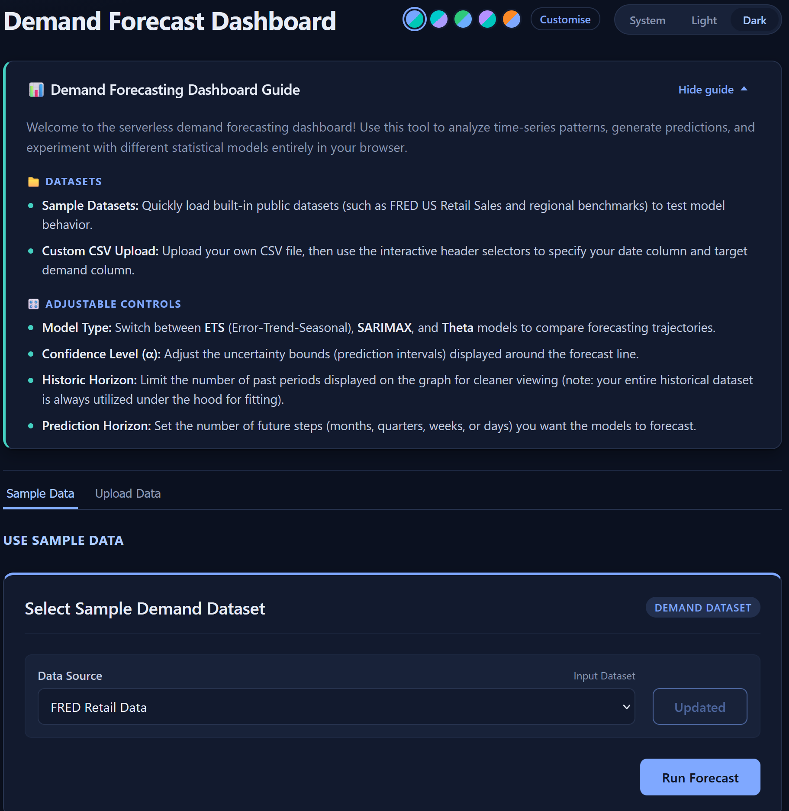
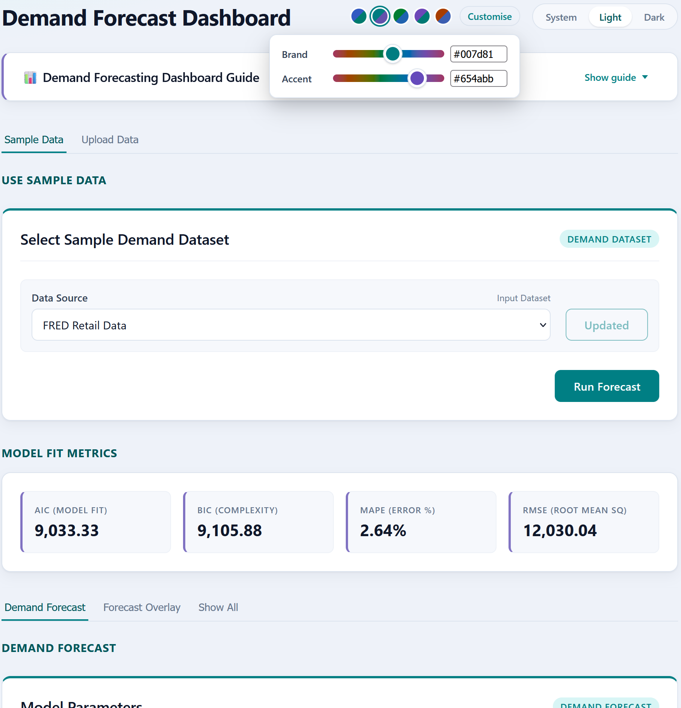
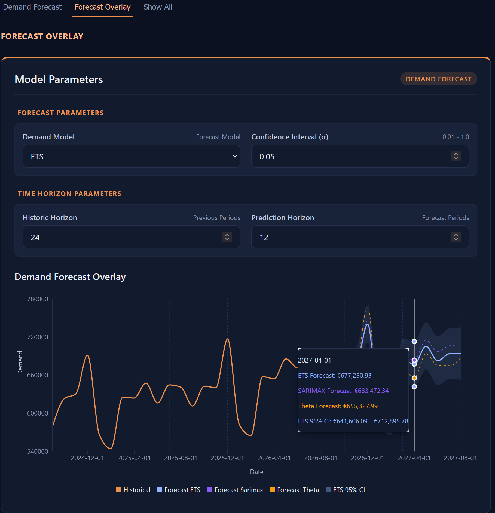

# Demand Forecasting Dashboard

An interactive, client-side web app for exploring and forecasting demand patterns in time-series data. Python models (`pandas`, `statsmodels`) run directly in the browser through WebAssembly (Pyodide), so there is no backend to host and uploaded data never leaves the user's machine.

**[Live demo](https://christopherdgibson.github.io/demand-forecasting-dashboard/)**

## Background

This project sits at the intersection of quantitative economics and modern frontend development. Moving time-series forecasting out of backend servers and into the browser shows how WebAssembly can connect data-science tools to responsive user interfaces, and keeps user data on the user's machine.

## Features

- **In-browser Python:** CPython, `pandas` and `statsmodels` run in WebAssembly via Pyodide, with no server or backend API workers.
- **Multiple models:** Compare Exponential Smoothing (ETS), SARIMAX, and Theta forecasts.
- **Confidence intervals:** Adjustable confidence level (α) with prediction bands on the chart.
- **Model comparison metrics:** AIC, BIC, MAPE and RMSE for each fitted model.
- **Your own data:** Upload a CSV and map its date and demand columns with an interactive header selector, or start from built-in public datasets (e.g. FRED US Retail Sales, `RSXFSN`).
- **Multi-periodicity:** Monthly, quarterly, weekly, and daily data, with resampling, gap filling and seasonal periods handled automatically.
- **Horizon controls:** Independent controls for historical periods and forecast predictions displayed. The display horizon does not change the dataset used to fit the models.
- **Clear error handling:** Python validation and convergence errors surface as a concise message in a dialog, with the full traceback available under "Show details".
- **Adaptive theming:** Light, dark or system-following themes, brand colour presets, and custom hue sliders. Preferences persist between visits.
- **Accessible UI:** Native radio inputs for theme and colour choices, `aria-expanded` disclosures, Escape-to-close and focus handling in dialogs, and reduced-motion support.

## Screenshots





## Architecture

Unlike a typical full-stack app that puts Python behind FastAPI or Flask, this project runs Python in the browser. In addition to facilitating online demonstration, this minimises technical requirements while keeping data securely on the user's local machine.

1. **Pyodide bootstrap (`usePyodide`):** Loads the Pyodide runtime and the `numpy`, `pandas` and `statsmodels` packages, then writes the Python source files into Pyodide's virtual file system (`MEMFS`).
2. **Python pipeline:** Parses dates, sorts, maps columns to a standard schema, resamples to the chosen frequency (`resample().sum().ffill().fillna(0)`), and fits the selected model with the matching seasonal period. A `DatetimeIndex` is kept throughout so `statsmodels` can interpret time intervals, and dates become strings only at the JSON boundary.
3. **Typed JS/Python bridge (`callPyFunction`):** A single generic function calls a named Python function, converts the result with `toJs`, and destroys the WASM proxies and runs `gc.collect()` afterwards to keep memory use low. Python code simply raises exceptions. The bridge catches them, extracts the exception type and message, and returns `{ success: false, type, message, trace }`, so callers must handle failure explicitly.
4. **Chart adapter:** Historical, forecast and confidence-interval series are merged into one dataset for Recharts, with the forecast drawn dashed and a custom tooltip and legend ordering.
5. **Theme layer:** Design tokens are CSS variables derived from two OKLCH hue values, with lightness set per theme. Charts, tooltips and controls all read the same variables, and a small inline script in `index.html` applies the saved theme before first paint to avoid a flash.

## Tech Stack

- **Frontend:** React, TypeScript, Recharts, Vite
- **In-browser runtime:** Pyodide (WebAssembly)
- **Modelling:** `statsmodels` (ETS, SARIMAX, Theta), `pandas`, `numpy`
- **Data:** Built-in public datasets (St. Louis Fed FRED, e.g. US Retail Sales `RSXFSN`) and user-uploaded CSV files

## Status

- [x] Pyodide WASM integration with Vite and React
- [x] CSV ingestion into the virtual file system (`MEMFS`)
- [x] Static deployment to GitHub Pages
- [x] Custom CSV upload with date and target column mapping
- [x] Multi-periodicity resampling and seasonal period mapping
- [x] Multi-model selection (ETS, SARIMAX, Theta)
- [x] Confidence interval visualisation
- [x] Model accuracy metrics
- [x] Horizon controls (history and prediction)
- [x] Python error bridge with an error dialog
- [x] Light/dark themes with colour presets and custom hues
- [ ] Model backtesting

## Running Locally

### Prerequisites

- Node.js 20 or later
- npm (or yarn)

No Python installation is needed. Python runs in the browser.

### Install and run

```bash
git clone https://github.com/christopherdgibson/demand-forecasting-dashboard.git
cd demand-forecasting-dashboard
npm install
npm run dev
```

Open the local URL Vite prints (typically http://localhost:5173). Pyodide downloads the WebAssembly runtime and Python packages on first load, which takes a few seconds.

### Build

```bash
npm run build
npm run preview
```

## Deployment (GitHub Pages)

The app is fully static. When deploying under a repository path:

- Set `base` in `vite.config.js` to `'/demand-forecasting-dashboard/'`.
- Load the Python files relative to that base, for example
  `` fetch(`${import.meta.env.BASE_URL}python/environment.py`) ``, not `/python/environment.py`, which would point at the domain root.
